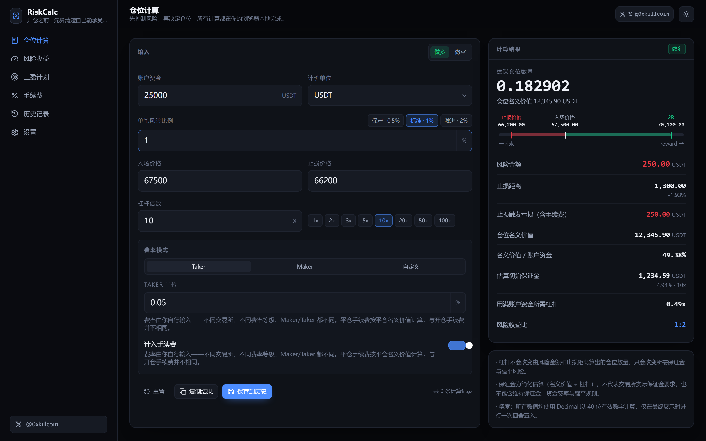
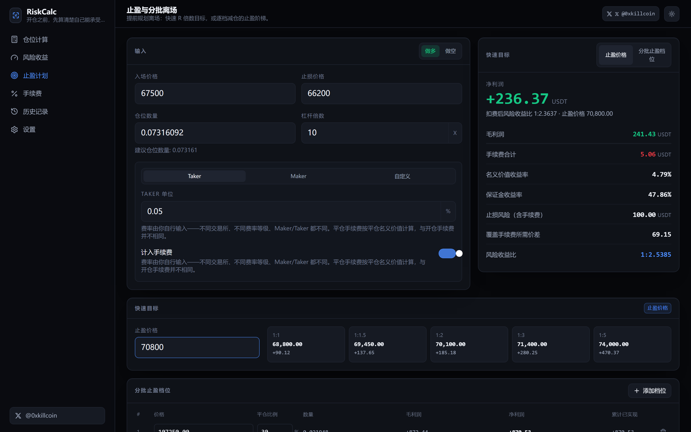
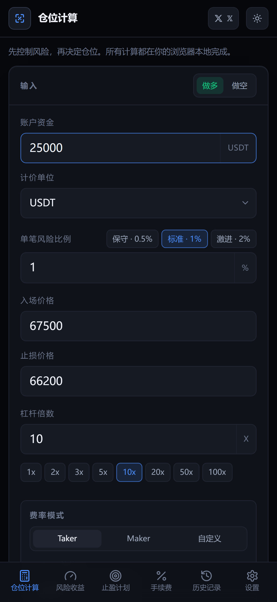

# RiskCalc — Know your risk before you trade

**RiskCalc** is a free, privacy-first trading risk calculator: position sizing, risk amount, stop distance, leverage & margin, risk/reward, take-profit targets, fees and break-even price. **100% local in your browser.**

- ✅ No sign-up
- ✅ No API keys
- ✅ No analytics
- ✅ No ads
- ✅ All calculations run locally

---

## Online Demo

https://iiiiiiiiiiiiiKK.github.io/riskcalc/

---

## Features

### Position Size Calculator
- Input: account balance, risk %, entry price, stop price, direction & leverage
- Output: suggested position quantity, risk amount, stop distance, margin estimate, break-even leverage

### Risk / Reward
- Verify your risk/reward ratio before entering a trade
- Quick R-multiple targets: 1:1, 1:1.5, 1:2, 1:3, 1:5

### Take Profit & Scale-Out
- Define multiple take-profit levels (up to 12)
- Automatic quantity allocation per level
- Realized PnL as exits trigger
- Support for partial exits, remaining position display

### Fee Calculator
- Enter your fee rates (maker/taker/custom)
- Open and close fees are distinct — close uses the **exit** notional
- Net PnL after all fees

### History
- Calculations are saved locally in the browser
- Export your history as JSON
- Delete or clear at any time

### Themes & Settings
- Dark / Light mode
- Language: Chinese | English
- Number display precision
- Default currency and fee presets

---

## Screenshots

### Desktop — Position Size (Dark)



### Desktop — Take Profit Planner



### Mobile — Responsive Layout



---

## Technical Architecture

| Layer | Tech |
| --- | --- |
| **Frontend** | React 18 + TypeScript 5 + Vite 5 |
| **Styling** | Tailwind CSS 3 + Heroicons (lucide-react) |
| **Math** | decimal.js (40 significant digits) |
| **Testing** | Vitest (unit) + Playwright (E2E) |
| **Deployment** | GitHub Pages (automatic) |
| **License** | MIT |

### Precision

**All numeric calculations use `decimal.js` with 40 significant digits.** Rounding happens *only* at render time, never during the calculation chain. This guarantees:

- No floating-point drift (e.g., 0.1 + 0.2 = 0.3, not 0.30000000000000004)
- Exact results even at extreme magnitudes
- Valid break-even prices down to sub-cent levels

---

## Installation (Local)

```bash
# Clone
git clone https://github.com/iiiiiiiiiiiiiKK/riskcalc.git
cd riskcalc

# Install dependencies
pnpm install

# Development server
pnpm dev

# Build for production
pnpm build

# Start preview server (for testing)
pnpm preview
```

### Run the Tests

```bash
# Unit tests (Vitest)
pnpm test

# E2E tests (Playwright)
pnpm e2e
```

---

## CI / CD

GitHub Actions automatically:

- Lints and type-checks the code
- Runs all unit and E2E tests
- Builds the production bundle
- Deploys to GitHub Pages on merge to `main`

---

## Riskcalc vs Real Exchanges

RiskCalc **does not** replace exchange margin calculations. It provides a simple, transparent estimate that helps you size a position within your risk budget. Actual results depend on:

- Slippage at fill time
- Funding and overnight fees
- Liquidity constraints
- Exchange-specific margin formulas
- Maintenance margin rules

RiskCalc is a **planning tool only**, not investment advice.

---

## Contributing

Bug reports and feature requests are welcome via GitHub Issues.

To contribute:

1. Fork the repository
2. Create a branch: `git checkout -b feature/your-feature`
3. Make sure tests pass: `pnpm test`
4. Open a Pull Request

---

## License

MIT License — see [LICENSE](LICENSE) for details.

---

## Author

**𝕏** [0xkillcoin](https://x.com/0xkillcoin)

---

## Changelog

### v1.0.0
- Initial stable release
- Position sizing with Decimal precision
- Risk/reward analysis
- Take-profit quick targets & scale-out ladder
- Fee calculator (open, close, taker/maker/custom)
- Break-even price calculation
- Multi-currency support (USDT, USDC, USD, BTC, ETH)
- History export & local storage
- Dark + Light themes
- English & Chinese UI
- Mobile-first responsive design